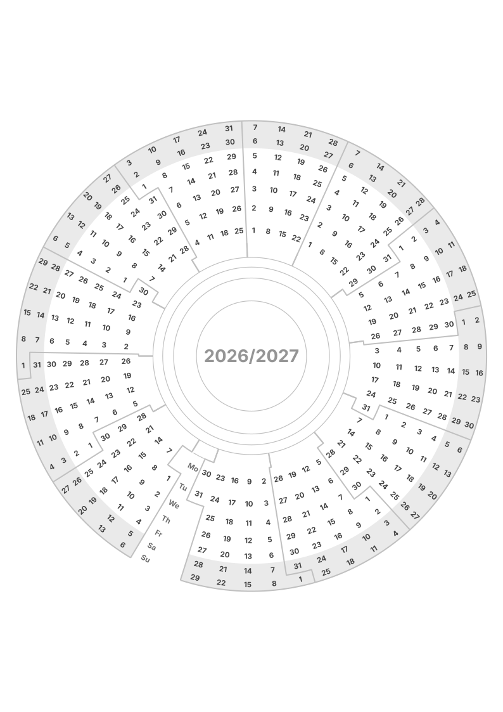

# Round Calendar

*Also available in Polish: [README](README_PL.md)*

A whole year on one A4 sheet, drawn as a disc.



## The idea

Weeks go round the edge like the hours on a clock, and each weekday is a ring, so all the
Mondays lie on one circle and the weekends make a band. The rings have equal areas: the outer
ones are thinner but longer. In the middle is the year, and round it the months, right inside
the days. Between them can go a band for the zodiac and counters — weeks of a school year,
months since a day — as thin bands of their own.

The year can start on any day — on 1 January, at the start of a school year — and runs for a
year from there. Where its end meets its start there is a seam: one column with the weekday names.
The seam is at the top, or the week of a chosen day. By default time runs clockwise and each week from the centre
outwards; either direction can be turned.

## Settings

A calendar is described by a few lines of plain text, one setting per line (`name: value`).
Blank lines and lines starting with `#` are ignored; every setting can be left out. Settings can
be written in English or in Polish — only the names on the sheet follow the language it is drawn in.

| Line | What it does |
|---|---|
| `year: 2026` | The year in which the calendar starts. Without it, the current year. |
| `from: 1.09` | The first day. The calendar runs to the day before the same date a year later. A full date (`1.09.2026`, `2026-09-01`) also sets the year. By default 1 January. |
| `top: 1.01` | The day whose week is at the top of the disc. Without it, the seam. |
| `first day: sun` | The weekday the week starts with on the radius: on the innermost ring, or with `weekdays: inwards` the outermost. Monday by default. `wed` puts the weekend in the middle. |
| `direction: anticlockwise` | Which way the weeks go round: `clockwise` (the default) or `anticlockwise`. |
| `weekdays: inwards` | Which way a week runs along the radius: `outwards`, from the centre (the default), or `inwards`, from the rim. |
| `months: short` | How the months are named: `full` (the default), `short` in three letters (`Jan`, `Feb`…) or `roman` numerals (`I`, `II`…). Full names shrink to fit when the inside is small. |
| `zodiac: signs` | How the zodiac is named: `full` (the default) or `signs` (♈ ♉ …). |
| `rings: zodiac, counters` | The bands between the year in the middle and the months, which are always there, from the centre outwards. `counters` sets where the counters go (else last, just inside the months). By default none. |
| `counter: weeks from 1.09 to 25.06 school weeks` | A band with weeks or months numbered from a day: 1, 2, 3…, each number over the days it holds, changing on exact days. A day without a year repeats: the count starts again from 1 each year. With a year (`from 2027-05-03`) it runs on and shows nothing before that day. `to` ends it on a day, the last one counted (`to 25.06`), or after a number (`to 40`); without it the count runs to the next start or the end of the calendar. Weeks of the calendar year start on its first Monday (`from 4.01.2027`). The name is optional; it stands just before the counter's start (number 1) — before the seam if it starts with the calendar or earlier — in place of the numbers it covers. Several `counter` lines give several bands. |
| `colors: weekend=#eaeaea, lines=#c0c0c0` | Colours of the weekend cells and of the lines. |
| `title: A.D. 2027` | The text in the middle of the disc instead of the year (or of `2026/2027` for a year that crosses New Year). Several `title` lines give several rows; `title: none` leaves the middle empty. The text is sized to fit. |
| `inside: 4` | The size of everything inside the months — the year and the bands — counted in months bands: from `1` to `5`, `3` by default; another number reads as the nearest of these. The year takes as much as one months band, and so does the zodiac by default; the bands share the inside, so the months and the days stay in place when bands are added or removed. `1` is a quarter of the radius, `5` a half. |
| `signature: The Smiths’ year` | A line in the bottom-right corner; several lines give several rows. |
| `format: 1` | The version of the file format. Saving a file adds it; a file without it is format 1. |

Polish keywords: `rok`, `od`, `góra`, `pierwszy dzień`, `kierunek` (`zgodnie z zegarem`, `przeciwnie do zegara`),
`dni tygodnia` (`od środka`, `do środka`), `miesiące` (`pełne`, `skrócone`, `rzymskie`), `zodiak` (`pełne`, `znaki`), `pierścienie`, `licznik`, `kolory`, `tytuł`, `wnętrze`, `podpis`;
units `tygodnie`, `miesiące`; `do` for `to`.

The week runs along the radius and on into the next column, so its order on the radius is always
the seven days in sequence; `first day` chooses where the sequence starts, `weekdays` which way it runs.

The bands are cycles too. A month or a sign cut by the seam is one stretch across it: in a calendar
from 15 March, the March at the end (2028) runs on into the March at the start (2027). Counters are not:
their numbers at the end and at the start differ, so they stop at the seam.

Lines stand only where they divide days: the steps between months, which run on across the months
band right inside the weekday rings. The other bands have no ticks; their labels
stand in the middle of their stretches.

Ready-made settings and the sheets drawn from them are in [`examples/`](examples).

## What is computed

- **Weekdays and leap years** for any Gregorian year (1583–2998).
- **Zodiac signs** use the fixed dates printed in calendars.

## Using the code

One TypeScript module, [`src/round-calendar.ts`](src/round-calendar.ts), with no dependencies and
no DOM access. It runs in the browser and in Node ≥ 22.12 (with `--experimental-strip-types`).

```ts
import { parseCalendar, renderCalendar, calendarRange, formatCalendar, withFormatLine } from 'round-calendar';
import { EXAMPLE } from 'round-calendar/examples';

const cal = parseCalendar(EXAMPLE.en, 'en', new Date().getFullYear()); // settings, cal.issues
calendarRange(cal);                     // { start, days }: the first day (days since 1970-01-01) and how many
const svg = renderCalendar(cal, 'en');  // <svg …> 210 × 297 mm
formatCalendar(cal, 'en');              // the settings as text again: the year, then what differs from the defaults
withFormatLine(text);                   // the text with a `format: 1` line, as saved to a file
```

`parseCalendar` never throws: lines it cannot read are listed in `cal.issues` with their line
numbers, and the rest is read as usual.

Install from GitHub: `npm install github:bsulkowski/round-calendar`, or with `#<commit>` at the end
to pin a version. The package ships the TypeScript source, so a bundler has to compile it (Vite
does; in an Astro or Vite SSR build, add `round-calendar` to `ssr.noExternal`).

### Compatibility

People keep their settings in text files and in their browsers, so a saved file has to read
the same way later. New features come as new keywords or new values that used to be errors,
never as a new meaning of existing text. The drawing itself may still improve.

Two numbers follow that: `FORMAT_VERSION` changes only if an old file could no longer be read
the same way, and a file from a newer format gets a warning; `TOOL_VERSION` changes with every
release — a new option → 1.1, a fix in the drawing → 1.0.1.

## Tests

```sh
npm test            # the settings, the range, the top and counters, every year draws
npm run examples    # redraw examples/
```

## History

The repository began in 2018 as a Groovy script that drew a single year with everything typed
in by hand. The layout — equal-area rings, stepped month borders, colours — comes from there;
it is in the git history, as is a later version with Polish holidays and your own dates marked
on the disc.

## Licence

[MIT](LICENSE) — Bartosz Sułkowski.
