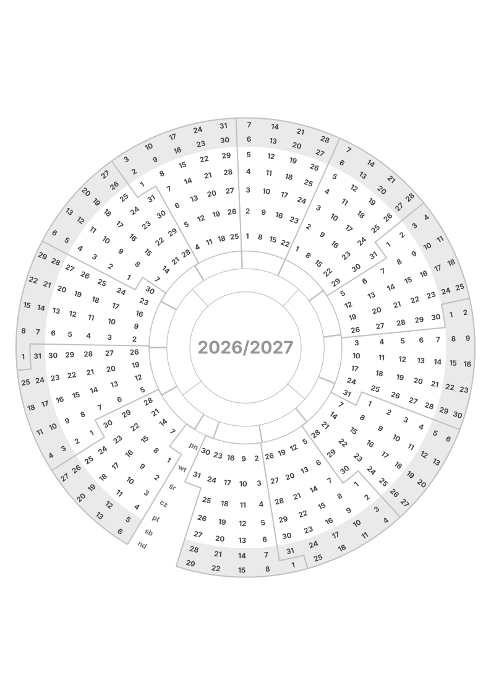

# Okrągły kalendarz

*Dostępne także po angielsku: [README](README.md)*

Cały rok na jednej kartce A4, narysowany jako koło.



## Pomysł

Tygodnie idą po obwodzie jak godziny na tarczy zegara, a każdy dzień tygodnia to pierścień:
wszystkie poniedziałki leżą na jednym okręgu, a weekendy tworzą pas. Pierścienie mają równe
pola — zewnętrzne są cieńsze, ale dłuższe. W środku są pasy pór roku (od prawdziwych równonocy
i przesileń), zodiaku i miesięcy, a pośrodku rok.

Rok może zaczynać się dowolnego dnia — 1 stycznia, na początku roku szkolnego, w pierwszy dzień
wiosny — i trwa od niego rok. Tam, gdzie jego koniec spotyka się z początkiem, jest łączenie:
jedna kolumna z nazwami dni tygodnia. Koło można obrócić tak, żeby na górze było łączenie, pora
roku, miesiąc albo wybrany dzień.

## Ustawienia

Kalendarz opisuje kilka linijek zwykłego tekstu, jedno ustawienie w linii (`nazwa: wartość`).
Puste linie i linie zaczynające się od `#` są pomijane; każde ustawienie można pominąć.
Ustawienia można pisać po polsku albo po angielsku — od języka rysunku zależą tylko nazwy
na kartce.

| Linia | Co robi |
|---|---|
| `rok: 2026` | Rok, w którym kalendarz się zaczyna. Bez tej linii — bieżący. |
| `od: 1.09` | Pierwszy dzień. Kalendarz trwa do dnia przed tą samą datą rok później. Pełna data (`1.09.2026`, `2026-09-01`) ustawia też rok. Domyślnie 1 stycznia. |
| `od: wiosna` | Pierwszy dzień pory roku (`wiosna`, `lato`, `jesień`, `zima`): dzień jej równonocy albo przesilenia. Kalendarz trwa do dnia przed jej następnym początkiem. |
| `góra: łączenie` | Co jest na górze koła: łączenie (domyślnie), środek pory roku (`zima`) albo miesiąca (`styczeń`), albo tydzień danego dnia (`1.09`). |
| `pierwszy dzień: nd` | Dzień tygodnia na najbardziej wewnętrznym pierścieniu; następne idą na zewnątrz. Domyślnie poniedziałek. `śr` daje weekend w środku. |
| `pierścienie: rok, pory roku, zodiak, miesiące` | Pasy wewnątrz pierścieni dni, od środka na zewnątrz. `rok` to koło pośrodku. Domyślnie rok, pory roku i miesiące. |
| `strefa: +1` | Strefa czasowa dla dat równonocy i przesileń. Domyślnie UTC. |
| `kolory: weekend=#eaeaea, linie=#c0c0c0` | Kolory pól weekendu i linii. |
| `tytuł: A.D. 2027` | Napis w środku koła zamiast roku (albo `2026/2027` dla roku przechodzącego przez Nowy Rok). |
| `podpis: Rok Nowaków` | Linijka w prawym dolnym rogu; kilka takich linii to kilka wierszy. |
| `format: 1` | Wersja formatu pliku. Zapis do pliku ją dodaje; plik bez niej to format 1. |

Angielskie słowa kluczowe: `year`, `from`, `top`, `first day`, `rings`, `timezone`, `colors`, `title`, `signature`.

Tydzień biegnie wzdłuż promienia na zewnątrz i dalej do następnej kolumny, więc jego kolejność
na promieniu to zawsze siedem dni po kolei; `pierwszy dzień` wybiera, od którego się zaczyna.

Pasy też są cyklami. Pora roku albo miesiąc przecięte łączeniem to jeden odcinek przez nie:
w roku szkolnym lato z końca (2027) przechodzi w lato z początku (2026).

Gotowe ustawienia i narysowane z nich arkusze są w [`examples/`](examples).

## Co jest liczone

- **Równonoce i przesilenia** według Meeusa, *Astronomical Algorithms*, rozdz. 27 — z dokładnością
  do około minuty, dla lat 1583–2998. Datę bierze się w strefie z `strefa:`.
- **Dni tygodnia i lata przestępne** dla dowolnego roku kalendarza gregoriańskiego.
- **Znaki zodiaku** mają stałe daty, jak w drukowanych kalendarzach.

## Użycie kodu

Jeden moduł TypeScript, [`src/round-calendar.ts`](src/round-calendar.ts), bez zależności i bez
dostępu do DOM. Działa w przeglądarce i w Node ≥ 22.12 (z `--experimental-strip-types`).

```ts
import { parseCalendar, renderCalendar, calendarRange, withFormatLine } from 'round-calendar';
import { EXAMPLE } from 'round-calendar/examples';

const cal = parseCalendar(EXAMPLE.pl, 'pl', new Date().getFullYear()); // ustawienia, cal.issues
calendarRange(cal);                     // { start, days }: pierwszy dzień (dni od 1970-01-01) i ile dni
const svg = renderCalendar(cal, 'pl');  // <svg …> 210 × 297 mm
withFormatLine(text);                   // tekst z linią `format: 1`, tak jak przy zapisie do pliku
```

`parseCalendar` nie rzuca wyjątków: linie, których nie umie przeczytać, trafiają do `cal.issues`
z numerami, a reszta czyta się normalnie.

Instalacja z GitHuba: `npm install github:bsulkowski/round-calendar`, albo z `#<commit>` na końcu,
żeby przypiąć wersję. Paczka zawiera źródło TypeScript, więc musi je skompilować bundler (Vite
to robi; w buildzie SSR Astro albo Vite dodaj `round-calendar` do `ssr.noExternal`).

### Zgodność

Ustawienia trzyma się w plikach tekstowych i w przeglądarkach, więc zapisany plik musi później
czytać się tak samo. Nowe funkcje przychodzą jako nowe słowa kluczowe albo nowe wartości, które
dotąd dawały błąd — nigdy jako nowe znaczenie istniejącego tekstu. Sam rysunek może się poprawiać.

Pilnują tego dwa numery: `FORMAT_VERSION` rośnie tylko wtedy, gdy stary plik przestałby się
czytać tak samo, a plik w nowszym formacie dostaje ostrzeżenie; `TOOL_VERSION` zmienia się
z każdym wydaniem — nowa opcja → 1.1, poprawka rysunku → 1.0.1.

## Testy

```sh
npm test            # równonoce vs. opublikowane, ustawienia, zakres i góra, rysowanie każdego roku
npm run examples    # przerysowanie examples/
```

## Historia

Repozytorium powstało w 2018 roku jako skrypt w Groovym, który rysował jeden rok z wszystkim
wpisanym ręcznie. Stamtąd pochodzi układ — pierścienie o równych polach, schodkowe granice
miesięcy, kolory; stary kod jest w historii gita, tak jak późniejsza wersja z zaznaczonymi
na kole polskimi świętami i własnymi datami.

## Licencja

[MIT](LICENSE) — Bartosz Sułkowski.
